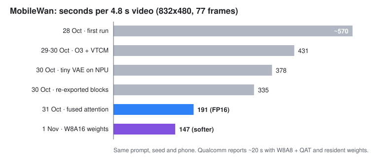
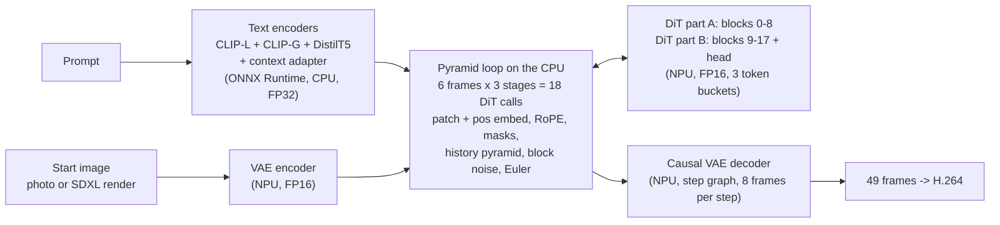
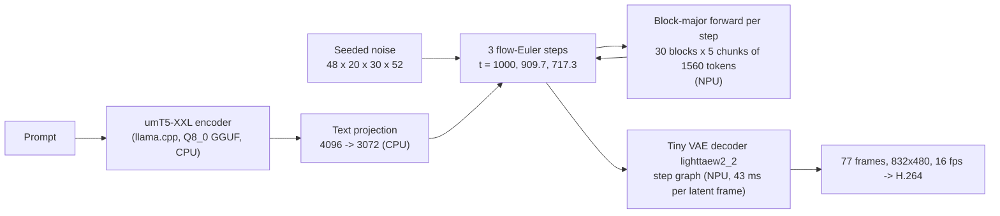
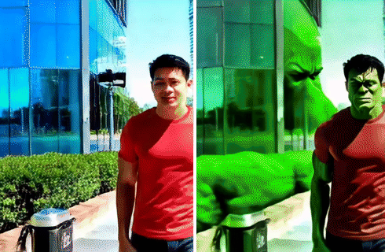

# On-device text-to-video on the Snapdragon 8 Elite Gen 5: running Neodragon and MobileWan on the Hexagon NPU

*Technical report, November 2026.
Ricardo de Koning*

This report describes how we got two of Qualcomm AI Research's mobile video-generation models,
**Neodragon** and **MobileWan**, running end to end on a phone with a Snapdragon 8 Elite Gen 5
(SM8850, Hexagon V81 NPU). It covers how each pipeline is put together, the graph rewrites that
made the difference on the NPU, and the measurements, including the experiments that did not
pay off. Qualcomm published both models as PyTorch weights. Their on-device
artifacts (quantized checkpoints, compiled graphs and the MobileWan decoder) were not public when we
started, so everything here was rebuilt from the released weights with the public QAIRT toolchain.

All numbers are measured on one phone (Snapdragon 8 Elite Gen 5, 16 GB RAM, HyperOS 4) with QAIRT
2.45. We tested inside an internal research app, *cocoLLM*. It is only a test harness: the NPU
runtime, the CPU glue and the encoders described below are ours, and the app itself is not part of this
report.

**Contents**

1. [Results at a glance](#1-results-at-a-glance)
2. [Platform and toolchain](#2-platform-and-toolchain)
3. [Neodragon on the NPU](#3-neodragon-on-the-npu)
4. [MobileWan on the NPU](#4-mobilewan-on-the-npu)
5. [8-bit MobileWan (W8A16)](#5-8-bit-mobilewan-w8a16)
6. [Instruction-based video editing (InstructPix2Pix)](#6-instruction-based-video-editing-instructpix2pix)
7. [Engineering lessons](#7-engineering-lessons)
8. [Gallery](#8-gallery)
9. [What is left](#9-what-is-left)
10. [References](#10-references)

---

## 1. Results at a glance

| Pipeline | Output | Time on the phone | Reference (paper) |
|---|---|---|---|
| Neodragon, text or photo to video | 2 s, 49 frames, 512x320, 24 fps | **11-15 s** end to end (5-6 s of NPU DiT) | 6.7 s for 640x1024 (Qualcomm) |
| Neodragon, long clip (chained 2 s parts) | 10 s, 241 frames | **40 s** | n/a |
| MobileWan, text to video | 4.8 s, 77 frames, 832x480, 16 fps | **191 s** (FP16), **147 s** (8-bit weights) | ~20 s (Qualcomm, W8A8 + QAT, resident graph) |
| InstructPix2Pix video edit | 512x384, per frame | **~4 s per frame** at 8 steps | MoViE: 12 fps (distilled 1-step model, not public) |

How the MobileWan time came down over five days, with the same prompt, seed and phone:

| Date | Change | End-to-end |
|---|---|---|
| 28 Oct | First end-to-end run: 30 blocks loaded one by one, CPU text encoder, CPU decoder | ~570 s |
| 29-30 Oct | O3 + 8 MB VTCM compile, HTP context-init acceleration | 431 s |
| 30 Oct | Tiny VAE decoder on the NPU (28.6 s -> 1.4 s) | 378 s |
| 30 Oct | Re-exported blocks: vector timestep input, separate chunk-0 graph, RoPE without ScatterND, weight-shared two-graph contexts | 335 s |
| 31 Oct | Local + recurrent attention as one exact fused softmax | **191 s** |
| 1 Nov | INT8 weights, 16-bit activations (all 30 blocks) | **147 s** (softer output) |

---

## 2. Platform and toolchain

- **SoC.** Snapdragon 8 Elite Gen 5 (SM8850), Hexagon V81 NPU (HTP), `soc_model` 87.
- **Runtime.** QAIRT / QNN 2.45 HTP backend, loaded in-process. Context binaries are created with
  `contextCreateFromBinary`, I/O tensors use zero-copy `rpcmem` buffers, and the HTP runs under a
  burst performance vote.
- **Graph build.** PyTorch -> ONNX (opset 17/18) -> `qairt-converter` (FP16 DLC, or FP32 DLC +
  `qairt-quantizer`) -> `qnn-context-binary-generator`. The binary generator runs **on x86 Linux
  (WSL)** whenever several graphs must share weights (see [section 7](#7-engineering-lessons)).
- **CPU side.** ONNX Runtime and llama.cpp (Arm NEON) for the text encoders, hand-written C++ for
  the per-step glue (patch embedding, positional encodings, masks, schedulers).
- **Measurement.** Per-graph NPU time comes from `qnn-net-run` with the HTP NetRun extensions
  (burst vote passed through the extension config), as the minimum of 4-8 runs. End-to-end times
  are wall clock on the phone, from prompt to MP4.

---

## 3. Neodragon on the NPU

Neodragon [1] is a pyramidal-flow text/image-to-video model: an 18-block MMDiT generates a 2 s clip
(7 latent frames, 16 channels, 40x64) autoregressively, one latent frame at a time. Each frame is
generated over 3 resolution stages with one Euler step per stage. We use the 320p DiT, 512x320 output.

### 3.1 Pipeline

- **The CPU glue is a line-for-line port of the reference loop.** It covers condition-clip
  selection, the 2x2 history pyramid, cropped sin-cos position tables, temporal RoPE, the causal
  attention mask, the stage timestep embedding, nearest upsampling plus the correlated block noise
  between stages, and Euler. Before porting it to C++, we checked a NumPy version of the same glue
  against the official pipeline at about 100 dB.
- **The DiT is split into two fixed-shape FP16 graphs** (blocks 0-8, and 9-17 plus the output
  head). Each takes 128 text tokens plus up to 1600 image tokens. Both stay resident between the
  18 calls of a clip.
- **The VAE decoder runs as a step graph** with explicit causal memories: one latent frame in,
  8 video frames out. Frames are converted to ARGB pixels in native code.

### 3.2 What made it fast

| Change | Effect |
|---|---|
| **Token buckets.** Stage 0 calls carry 80-280 image tokens, stage 1 carries 320-520 and stage 2 carries 1280-1600, but all were padded to 1600. We compiled 1600/640/320-token graphs into one context with **shared weights** | One block: 117 ms (1600) / 28 ms (640) / 17 ms (320). DiT per 2 s part: 13.5 s -> 5.3 s, 1 % larger file |
| **VAE encoder on the NPU** (see the fixes in 3.3) | 10-12 s on the CPU -> 1 s -> **0.22 s** |
| **Decoder output to pixels in native code** | 4.5 s -> 0.4 s per 49 frames |
| **Encoded prompts cached on disk**; DiT contexts created while the CPU encodes the text | 2 s clip: 19 s -> 15 s for a new prompt, **11 s** for a repeated one |
| Colour lock and hand-off sharpening run in parallel per frame | -1.4 s per part |

End to end for a 2 s clip, this went from 64 s to 11-15 s. A 10 s clip went from 143 s to 40 s.

### 3.3 Graph fixes for the VAE encoder (FP16)

The plain FP16 export of the causal VAE encoder produced garbage (0 dB SNR). We bisected the graph
stage by stage against FP32 and found two causes:

1. **Temporal-stride-2 Conv3d.** For a single input frame the causal time padding is zero, so the
   Conv3d equals a Conv2d using only the kernel's last time slice. Exporting it that way: 57 dB
   before the layer, 61.7 dB at the output (it was 0 dB).
2. **GroupNorm over 655k elements.** One FP16 reduction of that size is fragile, so we compute the
   statistics in two average-pool stages. Keep that code **4-D**: 5-D broadcasts in the rewritten
   GroupNorm fail HTP finalize.

Then a speed fix. A profile showed SiLU (Sigmoid) taking **51 %** of the encoder's cycles. A lone
SiLU on a 4-D `[1,128,320,512]` tensor costs 4.4 ms. The encoder's single-frame activations are
5-D `[1,C,1,H,W]`, and on those the same op was several times slower. Applying SiLU to the 4-D
view (same values) cut the encoder from 1.05 s to **0.22 s** at unchanged accuracy (61.7 dB).
**On the HTP, keep elementwise ops on 4-D tensors.**

### 3.4 Long clips and drift

The model is trained on 2 s. We make longer clips by chaining 2 s parts: each part starts from the
previous part's last frame. Our findings:

- **Part of the blur comes from the model itself.** In Qualcomm's own pipeline in FP32 on a PC, with
  the same start frame, sharpness (Laplacian variance) falls to 38-44 % of the first frame within
  the first 2 s. On the phone it falls to 31 %. Decoding the phone's latent with the PC VAE gives
  the same result, so the decoder is not the cause.
- **Every hand-off loses detail.** One VAE encode/decode round trip loses about 22 % (Laplacian
  variance 267 -> 208), and each part adds motion blur on top.
- **Colour drifts** (redder, darker) part after part. A luma + saturation lock toward the start
  frame fixes it. A global hue shift made it worse (snow turned teal when the subject's share of
  the frame changed).
- **Hand-off treatments tried:**

| Hand-off treatment | Result |
|---|---|
| Fixed 3x3 unsharp on the hand-off frame | Detail pops at each cut |
| Unsharp ramped 0 -> 0.45 over a part's last 12 frames | No pop. By 8-10 s the decoder's pixel grid shows as a mesh |
| Luma detail-lock targeting the first frame's detail | Under-sharpens: blurry from part 4 |
| Pre-smoothing before sharpening | Grid gone, but detail collapses |
| **"Detail refresh"**: redraw each hand-off frame with an image model (SDXL img2img, strength 0.3) | **Sharp to the end**, but the subject's look shifts slightly at each part. Costs ~14 s per part |

The trade-off is blur against grid. A 5 s clip holds up well; at 10-15 s, moving subjects soften
unless the hand-off frames are refreshed.

---

## 4. MobileWan on the NPU

MobileWan [2] is Wan2.2-TI2V-5B made mobile-friendly. Its 30-block DiT replaces full self-attention
with **hybrid attention**: softmax attention over a local window, plus a linear (polynomial-
feature) recurrent state that summarises everything earlier. It is head-pruned and distilled to
**3 sampling steps**. The released checkpoint is BF16. Qualcomm's phone version is W8A8 with
quantization-aware training and runs as one resident graph. Neither that version nor its optimized
decoder had been released when we started.

### 4.1 Pipeline

- **Chunks.** The 20 latent frames are processed as 5 chunks of 4 latent frames, which is 1560
  tokens per chunk (4 x 15 x 26). Each block keeps three things between chunks: the previous
  chunk's last 780 keys and values (the local window), and the recurrent state `s` (per head,
  384 x 128) and `z` (384).
- **Block-major order.** For each step, each block is loaded once and run over all 5 chunks in
  order, carrying its state. The 5 chunks wait at the block boundary, and the next block's file is
  read in the background. This is valid because block *b* at chunk *c* only needs block *b-1*'s
  output for chunk *c* and its own state from chunk *c-1*.
- **Two graphs per block in one context** with shared weights: a steady-chunk graph, and a chunk-0
  graph with no window cache and zero state, which matches the released recurrence exactly. Each
  block file holds both; a whole video is 30 files x 3 steps of context creation.
- **CPU I/O stages** (patch embedding, time embedding, RoPE tables, output head, unpatchify) are
  C++ ports of the diffusers modules, checked against a PC golden.
- **Text.** umT5-XXL (5.7 B parameters) runs through llama.cpp as a Q8_0 GGUF encoder in
  non-causal mode. Projected prompts are cached.
- **Decoder.** Qualcomm's distilled decoder is not released, and the stock Wan2.2 VAE does not fit
  in memory on a phone. We use LightX2V's `lighttaew2_2` tiny VAE [3], which the paper benchmarks
  as a near-equal alternative. Exported as a one-latent-frame step graph with 9 causal memories, it
  runs at **67.8 dB** vs FP32 and decodes the whole clip in 1.4 s on the NPU (28.6 s on the CPU).

### 4.2 Re-export of the blocks (335 s)

A per-op profile of the first compiled blocks gave three fixes, each exact:

1. **Timestep conditioning as a `[1, 6, 3072]` vector**, not the `[1, 1560, 6, 3072]` broadcast
   tensor (57 MB per call in FP16). The add / split / squeeze on the broadcast tensor cost about 10 %
   of each block.
2. **RoPE without ScatterND.** torch 2.4 exports the interleaved write `out[..., 0::2] = a;
   out[..., 1::2] = b` as **ScatterND**. That was 4 ops taking **979 of 2176 Mcycles** in block 22's
   self-attention. `torch.stack([a, b], -1).flatten(-2)` produces the same values with no
   ScatterND: 2176 -> 1322 Mcycles.
3. **A dedicated chunk-0 graph.** Chunk 0 had been running the steady graph against 780 zero
   overlap keys, which only approximated the released model (24 dB). The separate graph is exact
   and faster (149 ms vs 306 ms).

### 4.3 Fused hybrid attention (335 s -> 191 s)

The released local attention is written as separate ops:

$$m=\max_j l_j,\quad
o=\frac{\sum_j e^{l_j-m}\,v_j + R_n}{\sum_j e^{l_j-m} + R_d + \epsilon}$$

Here $l_j = q\cdot k_j$ over the window (780 cached + 1560 current keys), and $R_n = \phi(q)\,s$,
$R_d = \phi(q)\cdot z$ come from the recurrent state. On the HTP this ran as max, subtract, exp,
two matmuls, a sum and a divide. It took **416 ms** per 20-head steady chunk.

We rewrite it as **one standard softmax** with one extra key. Multiply the numerator and
denominator by $e^m$:

$$o=\frac{\sum_j e^{l_j} v_j + e^{m}(R_d+\epsilon)\,\frac{R_n}{R_d+\epsilon}}
        {\sum_j e^{l_j} + e^{m}(R_d+\epsilon)}$$

This is a softmax over the window keys plus one **extra key** with logit
$\lambda = m + \log(R_d+\epsilon)$. The extra key's value is the indicator $[0,\dots,0,1]$. Let $w$
be the softmax weight that lands in the indicator column; then

$$o = \text{softmax}([l, \lambda])\,[V; e] \;\Rightarrow\; o = A + w\,\frac{R_n}{R_d+\epsilon}$$

which is exactly the released output. Implementation details that mattered on the HTP:

- Q, K and V are padded from 128 to 160 dims. Column 128 carries λ (against the extra key's 1) and
  column 129 carries the padding logit, which lets the HMX run aligned tiles. Keys are padded to a
  multiple of 64.
- The row max $m$ is computed as $K Q^\top$ reduced over the **key axis** (dim 2), which was about
  **5x faster** than a max over the innermost axis.
- The chunk-0 graph uses a plain softmax (it has no recurrent state).

**Result:** the attention core went from 416 ms to **77 ms**. Block 22 went from 300 to 165 ms
(steady) and from 148 to 101 ms (chunk 0), with the same FP16 accuracy (51 dB on the attention
output). The whole video went from 335 s to **191 s**: NPU 125 s, block loading 31 s. Against the
unfused blocks the video is 36.9 dB PSNR, which is FP16 rounding.

### 4.4 Where the remaining time goes (FP16)

From a fresh run on 2 Nov (ocean prompt, 199 s end to end):

| Part | Time |
|---|---|
| NPU execute, 30 blocks x 5 chunks x 3 steps | 126 s |
| Block context creation (30 per step) | 26 s |
| Pauses between block contexts (DSP clean-up, 250 ms each) | 22.5 s |
| Prompt encode, CPU I/O, decoder, MP4 | ~25 s |

Qualcomm's 6.6 s per step [2] comes from two things we do not have:

- **W8A8 compute.** INT8 activations roughly double the HMX rate and halve the activation
  traffic. Their numbers depend on quantization-aware training.
- **One resident graph.** The 9.9 GB of weights stay loaded, so there is no per-block load or pause.

An FP16 block set is 10.2 GB, too large to keep resident next to the encoders on a 16 GB phone.

### 4.5 Things that did not help (measured)

| Tried | Result |
|---|---|
| INT8 weights with FP16 activations | 349 vs 318 ms per block: slower. The blocks are compute-bound |
| Q/K head dims permuted so RoPE needs no Split | 1-4 %, not worth a full re-export at the time (it became essential for INT8, see 5.1) |
| Local attention through `softmax` + max-of-probabilities instead of max/sub/exp | Slower: 430 vs 368 ms |
| Creating the next block's context while the current one runs | 414 vs 335 s: contention raised NPU execute by 10-25 % |
| Shorter pauses between blocks (0 or 100 ms instead of 250 ms) | Slower: execute rose more than the pause saved |
| Extra HMX / DDR power votes | No change |

---

## 5. 8-bit MobileWan (W8A16)

The MobileWan paper reports that post-training quantization alone loses visible quality, and that
they used QAT. We wanted to see how far careful PTQ gets.

### 5.1 Making an INT8 block compile at all

| Problem | Cause (found by bisecting the graph) | Fix (all exact in FP32) |
|---|---|---|
| INT8 prepare of one block ran out of memory **at 40 GB** | The interleaved RoPE (`stack` + `flatten`): alone 268 s to prepare, combined with the attention it blew up | RoPE on **contiguous halves**: permute each head's q/k output dims to [even \| odd] in the weights. The attention then prepares in 37 s at 0.6 GB; the full two-graph block in 3 min at 2.2 GB |
| "could not create op" on the polynomial feature maps | Batched MatMul with a static 3-D INT8 weight | Feature maps as **grouped 1x1 convolutions** |
| 16-bit MatMul operand rejected ("expected -32768") | The HTP wants a symmetric 16-bit second operand | `--restrict_quantization_steps "-0x8000 0x7F7F"`; `phi_q @ z` as Mul + ReduceSum |
| Attention logits quantized over [-1e4, 39] | The padding keys' logit of -1e4 | Padding logit -40 (real logits span about [-36, 39]), built as (-sqrt(40)) x sqrt(40) so the operands stay in range |
| Graph I/O quantized to 8 bit despite `--preserve_io_datatype` | The quantizer still quantizes at the graph edge | 16-bit overrides for the residual stream, state, timestep and RoPE inputs |
| **INT8 block 25x slower than FP16** (3.8 s vs 0.19 s) | The quantized `Pow` ops of the polynomial features (x^2, x^3): **95 % of the cycles** | Write the powers as multiplies (`c*c`, `c*c*c`) |

### 5.2 Calibration and validation

- **Calibration data.** We ran the whole pipeline on a PC in FP32, mirroring the phone's
  block-major chunked execution exactly, and saved every block's per-chunk inputs for 4 prompts
  x 3 steps (~40 GB). Three prompts calibrate, one is held out.
- **A fake-quant simulator.** It applies the quantizer's dumped encodings to the ONNX graph as
  QuantizeLinear/DequantizeLinear and runs it in ONNX Runtime. Checked against the phone, the
  simulator predicts the phone's INT8 accuracy **to within 0.5 dB** (block 22: 27.4 dB on the phone
  vs 27.9 dB simulated). We therefore compared all recipes on the PC.
- **Metric.** We report the SNR of the block's *update* (output minus input). The block output
  itself is dominated by the residual input and looks deceptively good.

| Recipe (block 22, held-out prompt) | Update SNR, steady chunk | Chunk 0 |
|---|---|---|
| W8A8, min-max | -6.0 dB | -5.9 dB |
| W8A8 + 16-bit residual stream and edges | -3.7 dB | -3.7 dB |
| W8A8 matmuls, everything else 16-bit | 11.6 dB | 10.7 dB |
| **W8A16** | **29.0 dB** | **20.2 dB** |

Why plain W8A8 fails here. The residual stream has one **massive-activation channel**: |x| up to
655, against a median channel of 1.4. LayerNorm leaves it at 55 (median 2). The quantizer gives the
LayerNorm output its own 8-bit range, so every other channel gets a quantization step of 0.35
*before* the AdaLN modulation shrinks channel 1938 again. QAT, or smoothing that channel into the
weights, would be needed for true W8A8.

### 5.3 Results

| Block 22 on the phone | FP16 (fused) | W8A16 |
|---|---|---|
| steady chunk | 189 ms | **135 ms** |
| chunk 0 | 116 ms | **73 ms** |

| Whole video (fox prompt, same noise) | FP16 | W8A16, all 30 blocks |
|---|---|---|
| End to end | 190 s | **147 s** |
| NPU execute | 123 s | 92 s |
| Block loading | 31.5 s | 23 s |
| Block files | 10.2 GB | 5.2 GB |
| Final latent vs PC FP32 | 16.7 dB | 5.1 dB |

- **Swapping a single block barely matters.** With one W8A16 block in an otherwise FP16 model, the
  final latent stays at 16.7 dB from FP32, unchanged: the INT8 error of one block is smaller than
  the FP16 error of the other 29.
- **With all 30 blocks quantized, the errors add up.** Across 30 blocks x 5 chunks x 3 steps the
  video keeps its scene, motion and composition, but it ends up **softer and paler**: the last
  frame's sharpness is 62 vs 86. Compare the two fox clips in the gallery.
- Per-block simulated update SNR ranges from 30 to 56 dB. Blocks 21-24 are the weakest.

---

## 6. Instruction-based video editing (InstructPix2Pix)

Qualcomm's MoViE [4] edits video at 12 fps on a phone, using a guidance-distilled one-step model
that is not public. As a baseline we ran its base model, **InstructPix2Pix** [5] (SD 1.5), frame by
frame on the NPU:

- **TAESD encoder and decoder** [6]: 5-6 ms per frame each (FP16). TAESD latents divided by 0.18215
  give the unscaled VAE latents that InstructPix2Pix conditions on (checked: factor 5.55,
  cosine 0.98 against the SD VAE).
- **UNet: 145 ms per call** at 512x384 (FP16, 58.5 dB vs FP32). Text and image guidance need 3
  calls per step. A 384x512 portrait graph is the same.
- **CLIP text encoder** on the CPU (~1 s, once per video).
- Euler-ancestral sampling with **the same seeded noise for every frame**, which keeps the edit
  consistent across frames.

| Instruction (2 s, 16 frames, 8 steps) | Result |
|---|---|
| "make his shirt blue" | Only the shirt changes, consistent across frames. 62 s |
| "turn him into the hulk" (portrait) | Hulk from the 2nd frame on; green spills onto the background. 74 s |
| "make it a Van Gogh painting", image guidance 1.5 | Painted, but 2 of 16 frames jump to a *Starry Night* scene |
| same, image guidance 2.0 | Painted, all frames consistent |
| same, each frame started from the previous edit, re-noised to step 4 of 8 | 2x faster but drifts into *Starry Night* |
| LCM-LoRA, 4 steps (PC) | Discards the source scene: does not work for editing |

That is about 4 s per frame against MoViE's 0.08 s. Distillation to one step, which the authors
did with GAN training, accounts for almost all of the difference. Live-camera editing is not
feasible without it.

---

## 7. Engineering lessons

1. **Weight sharing between graphs only works when the context is prepared on x86 Linux.**
   Preparing on the phone or on Windows silently gives every graph its own copy of the weights.
   The x86 prepare needs `"soc_model": 87` and `"hvx_threads": 8` in the HTP config. Without them
   the same graphs ran 4-5x slower on the phone.
2. **Measure with a held burst vote.** `qnn-net-run --perf_profile burst` alone did not hold the
   NPU clock: one binary timed 0.3-1.8 s depending on screen state and background load. Passing
   the vote through the HTP NetRun extension config gave stable times (block 22: 310-320 ms every
   run). Also wait for the NSP to cool below ~45 °C between runs, and wait after a reboot.
3. **Bisect against FP32.** Every bad graph we hit had a single culprit layer: the temporal-stride
   Conv3d, the ScatterND RoPE, the interleaved RoPE in INT8, the quantized `Pow`. Export the
   pipeline in stages and compare each stage's SNR against FP32.
4. **Rank 5 is slow, and so are some exports.** Keep elementwise ops on 4-D tensors. Check the
   ONNX export for ScatterND and for batched MatMuls with constant weights.
5. **Exact rewrites beat approximations.** All the big wins (fused attention, half-split RoPE,
   grouped-conv feature maps, powers as multiplies, Conv3d -> Conv2d) are algebraically exact. We
   verified each in FP32 to more than 120 dB before compiling.
6. **Memory pressure is an OS problem too.** The phone's vendor OS force-stops apps that hold
   several GB of DMA buffers while memory is short. Free other models before creating large
   contexts.
7. **Verify pushed binaries.** Files occasionally vanished from a folder after an `adb push` that
   reported success. Verify md5 sums on the device before timing anything.

---

## 8. Gallery

All clips were generated on the phone on 2 Nov. Each GIF is a downscaled preview at a reduced
frame rate; the linked MP4 is the original output, unedited.

About the times: the clips were generated back to back with no cool-down, and each run started
the test process fresh. So they include model loading and a warming phone, and they are slower
than the best times in Section 1 (measured warm and cool). They are honest numbers for a
"cold start, busy phone" run.

### 8.1 MobileWan, text to video (832x480, 77 frames, 16 fps, FP16 "Quality")

| Preview | Prompt, seed, time |
|---|---|
|  | Waves breaking against sea cliffs at sunset (the exact prompt text was not logged). Seed 11. **199 s.** [MP4](media/mw_ocean.mp4) |
|  | *A busy city street at night in the rain, neon signs reflecting on the wet pavement, people with umbrellas walking past.* Seed 21. **237 s.** The reflections and rain hold up; the signs are unreadable glyphs, as usual for a model this size. [MP4](media/mw_city_rain.mp4) |
|  | *A golden retriever puppy chasing a red ball across green grass in a sunny park, shallow depth of field.* Seed 5. **249 s.** [MP4](media/mw_puppy.mp4) |
|  | *A hot air balloon rising slowly over misty mountains at sunrise, aerial view, soft golden light.* Seed 8. **274 s.** [MP4](media/mw_balloon.mp4) |
|  | *A chef in a white apron chopping vegetables in a bright modern kitchen, close-up of the hands and the knife.* Seed 3. **273 s.** Hands and knife stay coherent through the cut. [MP4](media/mw_chef.mp4) |
|  | *Glowing jellyfish drifting through dark blue deep ocean water, bioluminescent, slow graceful motion.* Seed 14. **265 s.** [MP4](media/mw_jellyfish.mp4) |

The times rise from 199 s to 274 s over the session as the phone heats up. From the first to
the last back-to-back run, NPU execution rose from 130 s to 146 s (+12 %) and block loading
from 34 s to 51 s (+50 %): loading suffers more from heat than compute does.

### 8.2 MobileWan, FP16 vs 8-bit weights (same prompt and seed)

*A red fox running through deep snow in a pine forest, the camera tracking alongside it.* Seed 42.
Left: FP16 blocks, **217 s** ([MP4](media/mw_fox_quality.mp4)). Right: W8A16 blocks, **179 s**
([MP4](media/mw_fox_fast_int8.mp4)). Same scene, layout and motion; the INT8 fur is paler and
softer, as Section 5 describes. Both runs are about 30 s slower than the warm best times
(191 s and 147 s). The model also reads "running" loosely: the fox walks toward the camera.

### 8.3 Neodragon, text to video (512x320, 49 frames, 24 fps, 2 s)

| Preview | Prompt, seed, time |
|---|---|
|  | *A sailboat gliding across a calm lake at sunset, mountains in the background.* Seed 7. **52 s.** It drew two boats. [MP4](media/nd_sailboat_2s.mp4) |
|  | *A hummingbird hovering next to a bright red flower, wings blurred, garden background.* Seed 7. **51 s.** [MP4](media/nd_hummingbird_2s.mp4) |
|  | *A steam train crossing an old stone bridge in an autumn forest, smoke rising.* Seed 7. **46 s.** [MP4](media/nd_train_2s.mp4) |
|  | *A campfire crackling at night in a pine forest, sparks rising into the dark sky.* Seed 7. **46 s.** The flames are good; the smoke turns into drifting red blobs, a failure case. [MP4](media/nd_campfire_2s.mp4) |

Each of these is a cold start. In the sailboat run the denoising itself took **8.0 s** (7.4 s
of it on the NPU); the other ~44 s is loading the text encoder, the DiT contexts and the
decoder. With the models already loaded, a 2 s clip takes the 11-15 s quoted in Section 1.

### 8.4 Neodragon, 5 s clips: plain chaining vs detail refresh (same prompt and seed)

A 5 s clip is three chained parts (2 s, 2 s and 1 s, about 8 s of denoising each for the
2 s parts). Each part starts from the last frame of the one before,
and without help the detail washes out part by part (Section 3). Left: plain hand-off. Right:
detail refresh at strength 0.3, which re-noises the hand-off frame and denoises it again
before the next part starts.

*Colourful koi fish swimming in a clear pond with lily pads, top-down view.* Seed 7.
Plain, **61 s** ([MP4](media/nd_koi_5s_plain.mp4)): by the third part the water shows a block
pattern and the fish loses its scales. Refresh, **53 s** ([MP4](media/nd_koi_5s_refresh.mp4)):
the texture holds to the end, but the lily pads are redrawn at the first hand-off. That
reshaping is why the switch is off by default.

*A red fox running through deep snow in a pine forest, the camera tracking alongside it.* Seed 7.
Plain, **56 s** ([MP4](media/nd_fox_5s_plain.mp4)): the fox and the trees blur steadily from
the second part on. Refresh, **59 s** ([MP4](media/nd_fox_5s_refresh.mp4)): fur and snow stay
sharp to the last frame.

The refresh costs one short img2img pass per hand-off. Here it is lost in the run-to-run
noise of a cold start.

### 8.5 InstructPix2Pix video edits (2 s, 16 frames, 8 steps)

The source clips are MobileWan outputs (left in each preview).

*"make his shirt blue"*: only the shirt changes, and it stays consistent across frames. **62 s.**
[Source](media/edit_source_landscape.mp4) · [Edit](media/edit_blue_shirt.mp4)

*"turn him into the hulk"*, portrait graph: the change takes from the second frame on, and green
spills onto the background. **74 s.** [Source](media/edit_source_portrait.mp4) ·
[Edit](media/edit_hulk.mp4)

*"make it a Van Gogh painting"*. Left: source. Middle: image guidance 1.5; two of the 16 frames
jump to a *Starry Night* scene ([MP4](media/edit_van_gogh_ig1.5.mp4)). Right: image guidance
2.0; every frame stays tied to the source ([MP4](media/edit_van_gogh_ig2.0.mp4)). 2.0 is now the
default.

The PC FP32 reference renders behind the quality numbers in Sections 4 and 5 (MobileWan FP32 vs
FP16 vs INT8) are not included yet. Their reference renders are on an offline drive and will
be added later.

---

## 9. What is left

- **MobileWan at ~20 s needs W8A8 plus resident weights.** The remaining paths: quantization-aware
  training (block-wise distillation fits on one 24 GB GPU), or Qualcomm's own mobile artifacts,
  which the authors have said will follow. Our block-major runner already takes multi-graph INT8
  contexts.
- **Better PTQ for the weak blocks.** Options: more calibration data (we used 8 samples per graph),
  keeping blocks 21-24 in FP16, or smoothing the massive-activation channel into the weights.
- **Cross-frame attention for editing.** Fairy/MoViE-style anchor-frame keys and values would need
  a UNet export with extra K/V inputs.

---

## 10. References

1. A. Karnewar et al., *Neodragon: Mobile Video Generation using Diffusion Transformer*,
   arXiv:2511.06055 (ICLR 2026). Weights: <https://huggingface.co/Qualcomm-AI-Research/Neodragon>
2. Qualcomm AI Research, *MobileWan* (Closing the Quality Gap for Mobile Video Diffusion),
   arXiv:2607.06173. Code: <https://github.com/Qualcomm-AI-research/mobilewan>,
   weights: <https://huggingface.co/Qualcomm-AI-Research/mobilewan>
3. LightX2V, tiny VAE `lighttaew2_2`: <https://huggingface.co/lightx2v/Autoencoders>
4. N. Fathima et al., *MoViE: Mobile Diffusion for Video Editing*, arXiv:2412.06578.
   Project page: <https://qualcomm-ai-research.github.io/mobile-video-editing/>
5. T. Brooks, A. Holynski, A. Efros, *InstructPix2Pix: Learning to Follow Image Editing
   Instructions*, arXiv:2211.09800
6. O. B. Bohan, *TAESD: Tiny AutoEncoder for Stable Diffusion*: <https://github.com/madebyollin/taesd>
7. Y. Jin et al., *Pyramidal Flow Matching for Efficient Video Generative Modeling*, arXiv:2410.05954
8. Wan Team, *Wan2.2-TI2V-5B*: <https://huggingface.co/Wan-AI/Wan2.2-TI2V-5B-Diffusers>

The models are the work of their authors and remain under their own licences. This report
describes how we ran them; it contains no model weights.
